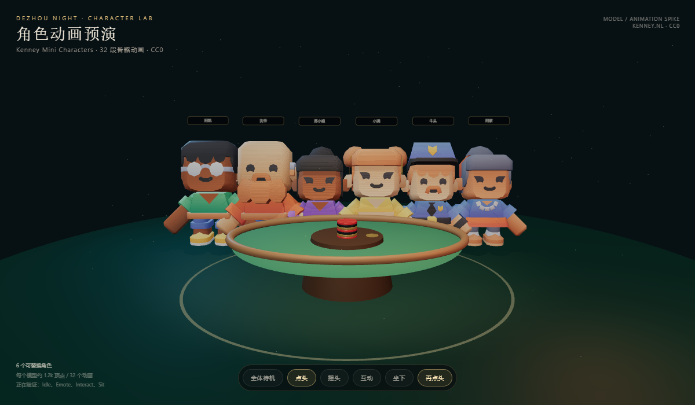

# 角色模型与对局动画预演测试报告

> 状态：预演通过，未接线上  
> 日期：2026-10-26  
> 环境：Windows + Edge/Playwright + SwiftShader  
> 证据：`evidence/character-lab.png`

## 1. 模型获取

- 来源：Kenney Mini Characters 1.0
- 许可：CC0
- 下载包：2,403,059 字节
- 使用角色：
  - character-male-a/b/c
  - character-female-a/b/c
- 每角色约 245-273KB、32 段骨骼动画
- 许可：[KENNEY-LICENSE.txt](evidence/KENNEY-LICENSE.txt)

## 2. Blender

安装：

```text
Blender 4.5.10 LTS
C:\Program Files\Blender Foundation\Blender 4.5\blender.exe
```

自制道具：

```text
Blender Python 创建 7 枚筹码 + 1 个 Dealer Button
导出 public/models/kenney/poker-props.glb
大小 217,320 字节
```

脚本：`evidence/blender-props.py`

## 3. Three.js 预演

页面：`model-preview.html`

加载结果：

```text
actors = 6
GLB/贴图 404 = 0
pageerror = 0
```

动画切换：

```text
点击「点头」
window.__characterLab.actors[0].current.getClip().name = emote-yes
```

说明动画状态实际切换，不只是静态模型。

截图：



## 4. 过程中修复

- 最初 GLB 使用 `/models` 路径，静态服务器从 `/public` 提供，导致404；
- GLB 依赖外部 `Textures/colormap.png`，已补到 `public/models/kenney/Textures/colormap.png`；
- 最初角色围成圆桌，近端角色背对镜头且遮挡严重；
- 改为面向镜头的弧线站位，镜头拉远，6 个角色完整可见；
- 增加 Hemispheric/Ambient/Directional 补光，避免脸部全黑；
- 使用 Blender 生成筹码堆，放在桌中央。

## 5. 结果

| 项目 | 结果 |
|---|---|
| 免费模型可获取 | 通过 |
| CC0 许可 | 通过 |
| GLTFLoader 加载 | 通过 |
| 6 角色同屏 | 通过 |
| idle 动画 | 通过 |
| emote/interact/sit | 通过 |
| Blender 安装 | 通过 |
| Blender 自制道具 | 通过 |
| 视觉明显优于方块人 | 主观通过 |
| 正式游戏接入 | 未开始 |
| APK/真机 | 未测试 |

## 6. 风险

- Kenney 是低模方块卡通，不是写实质感；
- 6 个模型约 1.5MB，8 个约2MB；
- 8 个 AnimationMixer 在低端机可能掉帧；
- 角色衣服与 5 场景服装尚未绑定；
- 预演页未打包进正式 APK。

## 7. 结论

已验证：**能获取免费 CC0 骨骼角色，能在 Three.js 播放动画，能用 Blender 制作道具**。

尚未进行正式牌桌替换；需要下一阶段单独开发、性能测试和真机验收。
